<div align="center">

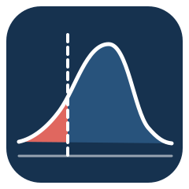

# Making Tail Constraints Bind

**Two Silent Failure Modes in CVaR-Constrained Portfolio RL**

**Nigel Li** · **Yutong Han** · Columbia University

*ICAIF '26 · 7th ACM International Conference on AI in Finance · Milan, 14–17 November 2026*

<p>
  <a href="https://github.com/nl2992/cvar-rl-portfolio-allocator/stargazers"></a>
  <a href="https://github.com/nl2992/cvar-rl-portfolio-allocator/network/members"></a>
  <a href="https://github.com/nl2992/cvar-rl-portfolio-allocator/actions/workflows/ci.yml"></a>
  <a href="pyproject.toml"></a>
  <a href="LICENSE"></a>
</p>

<a href="paper/main.pdf"><b>📄 Paper</b></a> ·
<a href="poster/poster.pdf"><b>🖼️ Poster</b></a> ·
<a href="#-quick-start"><b>🚀 Quick start</b></a> ·
<a href="#-reproducing-the-paper"><b>🔁 Reproduce</b></a> ·
<a href="#-citation"><b>📝 Cite</b></a>

</div>

---

## 📰 News

- **2026-11** — Poster presentation at **ICAIF '26**, Milan.
- **2026-10** — Camera-ready paper, A0 poster and full reproduction code released in this repository.
- **2026** — Paper accepted at **ICAIF '26**, the 7th ACM International Conference on AI in Finance.

---

## 💡 Why this project?

An allocator trained only to earn return has no reason to avoid large losses. The standard remedy is a **CVaR budget** imposed through a **Lagrangian penalty**. We show that this remedy can fail with no visible symptom, and that the usual way of checking it can mislead.

> [!IMPORTANT]
> **The claim is narrow:** the constraint pipeline and a decision-time filter reduce tail risk and restore out-of-sample budget compliance. We do **not** claim that the learned allocator generates alpha or beats rolling minimum variance.

The paper splits one question — *does a tail-risk limit on an RL allocator do what we think it does?* — into two:

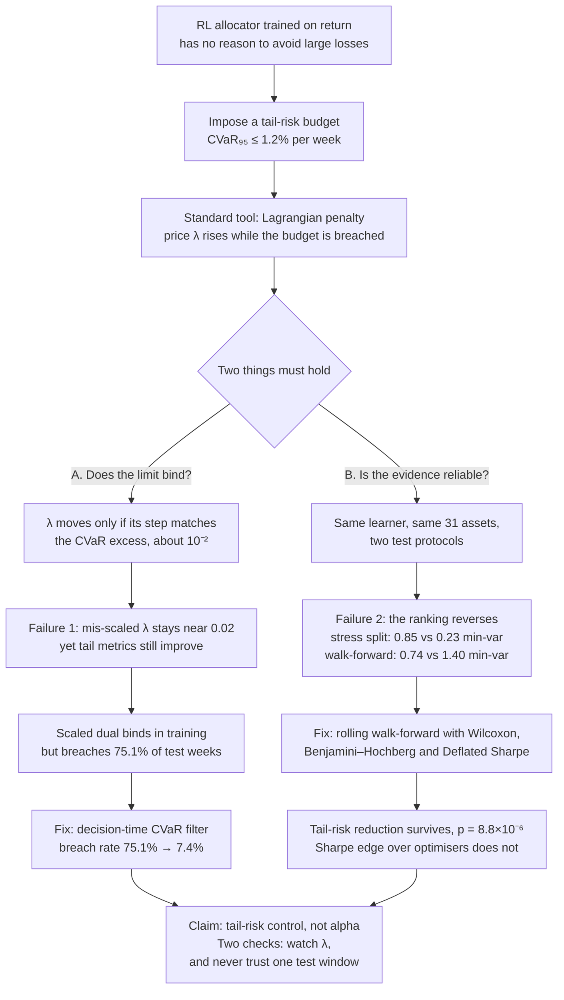

---

## 🖼️ Paper & poster

<table>
  <tr>
    <td align="center" width="50%">
      <a href="paper/main.pdf">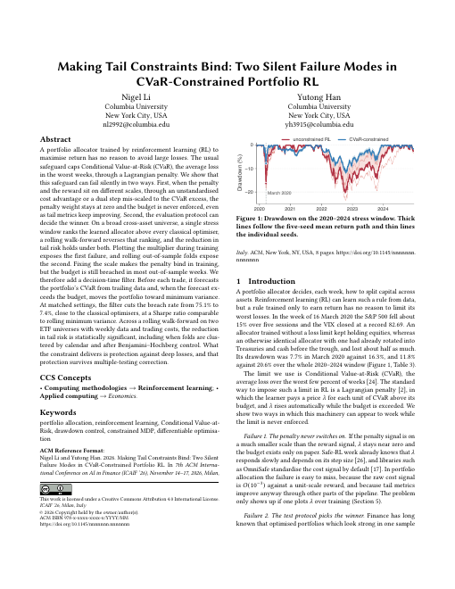</a><br/>
      <b>Paper</b> (8 pages, ACM format)<br/>
      <a href="paper/main.pdf">PDF</a> · <a href="paper/main.tex">LaTeX source</a>
    </td>
    <td align="center" width="50%">
      <a href="poster/poster.pdf">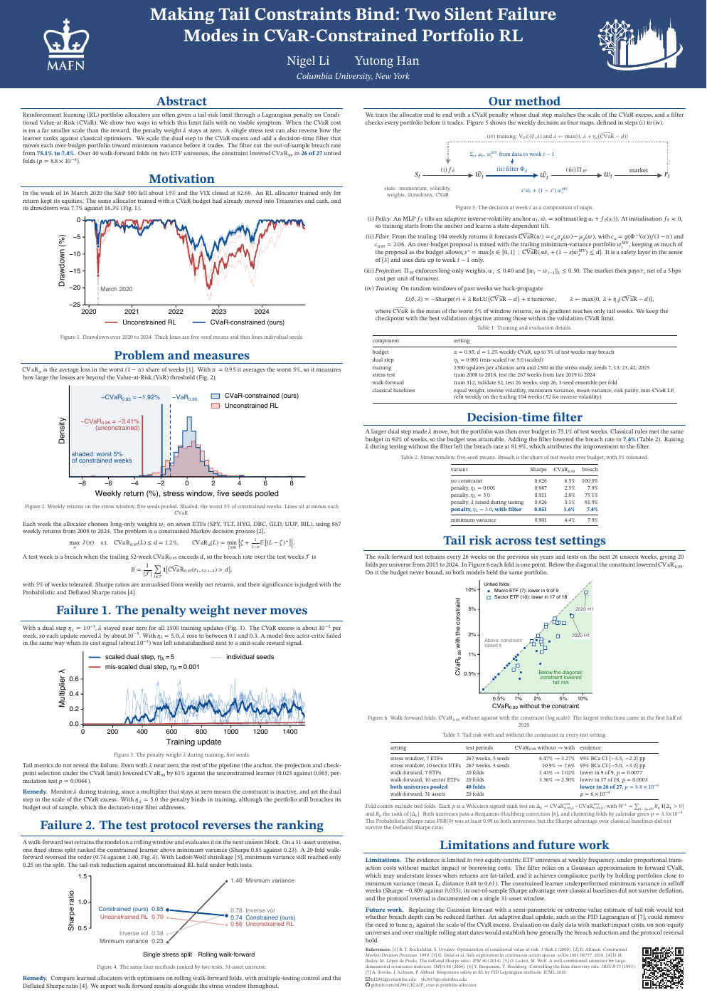</a><br/>
      <b>Poster</b> (A0 portrait)<br/>
      <a href="poster/poster.pdf">PDF</a> · <a href="poster/poster.tex">LaTeX source</a>
    </td>
  </tr>
</table>

---

## 🔍 The two failure modes

### Failure 1 · The penalty weight never moves

The penalty adds $`\lambda\,\mathrm{ReLU}(\widehat{\mathrm{CVaR}}-d)`$ to the loss, and $`\lambda`$ follows dual ascent:

```math
\lambda\leftarrow\max\{0,\ \lambda+\eta_\lambda(\widehat{\mathrm{CVaR}}-d)\}.
```

The CVaR excess is about $`10^{-2}`$ in weekly-return units while the return objective is of order one, so the step $`\eta_\lambda`$ must be scaled to match:

| | Mis-scaled dual | Scaled dual |
| --- | :---: | :---: |
| Step $`\eta_\lambda`$ | `0.001` | `5.0` |
| Change in $`\lambda`$ per breaching update | $`10^{-5}`$ | $`0.05`$ |
| Final $`\lambda`$ after 1,500 updates (5-seed mean) | `0.022` | `0.101` |

With the mis-scaled step the budget exists only on paper — yet tail metrics still improve, because the anchor, the projection and CVaR-aware checkpoint selection lower tail risk on their own. **Nothing flags the failure unless you plot λ.**

<p align="center">
  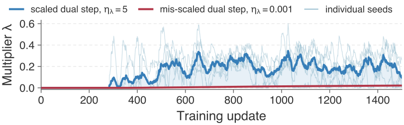
</p>
<p align="center"><em>With a mis-scaled step (η<sub>λ</sub> = 0.001) the penalty weight λ barely leaves zero, so the CVaR budget never shapes the policy. Penalty weight during training, five seeds.</em></p>

Scaling the dual makes the penalty bind in training, but the selected policy **still breaches the budget in 75.1% of test weeks** once the return distribution shifts.

### Failure 2 · The test protocol reverses the ranking

<p align="center">
  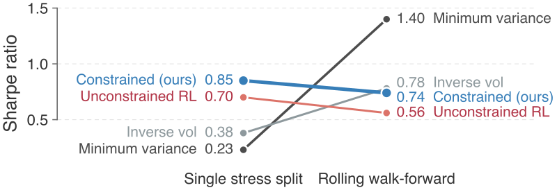
</p>
<p align="center"><em>The Sharpe ranking against minimum variance reverses with the test protocol: the learner leads on a single stress split (0.85 vs 0.23) and trails under a 20-fold walk-forward (0.74 vs 1.40). Same learner, same 31 assets.</em></p>

---

## 🛠️ Our solution

The learner is a residual allocator over an inverse-volatility anchor, trained end-to-end through realised portfolio returns with a differentiable CVaR penalty. A **decision-time filter** then checks every trade.

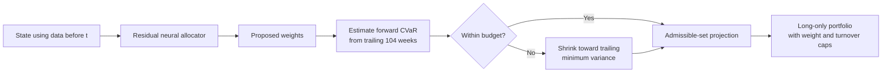

| Component | Equation | Why |
| --- | --- | --- |
| **Policy** | $`w_t=\mathrm{softmax}\big(\log a_t+f_\theta(s_t)\big)`$ | Starts as the anchor $`a_t`$ and learns only a tilt; long-only by construction. |
| **Loss** | $`\mathcal{L}=-\mathrm{Sharpe}(r)+\lambda\,\mathrm{ReLU}(\widehat{\mathrm{CVaR}}-d)+\kappa\cdot\text{turnover}`$ | Exact gradients through net returns; CVaR via `torch.topk` acts only on the worst weeks. |
| **Filter estimate** | $`\widehat{\mathrm{CVaR}}(w)=c_\alpha\sqrt{w^\top\Sigma w}-\mu^\top w,\ c_{0.95}=2.063`$ | Cheap, uses only returns before week $`t`$. |
| **Filter step** | $`w(s)=m+s(w^{\text{prop}}-m),\ s^\star=\max\{s\in[0,1]:\widehat{\mathrm{CVaR}}(w(s))\le d\}`$ | Smallest change to the proposal that meets the budget. |

The filter is a test-time enforcement layer, not another soft penalty, and a dedicated test ([`tests/test_risk_filter_no_lookahead.py`](tests/test_risk_filter_no_lookahead.py)) verifies the decision at week `t` is unchanged when future returns are shifted.

<details>
<summary><b>Worked example: one filter decision on 6 March 2020</b></summary>

<br/>

Seven-ETF panel, 104 weeks before the decision. The proposal is an illustrative equity-heavy portfolio.

| Asset | Proposal | Min-variance anchor $`m`$ | After filter |
| --- | ---: | ---: | ---: |
| SPY (equity) | 0.400 | 0.000 | 0.165 |
| TLT (rates) | 0.000 | 0.042 | 0.024 |
| HYG (credit) | 0.300 | 0.206 | 0.245 |
| DBC (commodity) | 0.200 | 0.000 | 0.083 |
| GLD (gold) | 0.100 | 0.073 | 0.084 |
| UUP (US dollar) | 0.000 | 0.279 | 0.164 |
| BIL (cash) | 0.000 | 0.400 | 0.235 |

1. **Proposal:** $`2.063\times1.32\%-0.067\%=2.66\% > d=1.2\%`$, so the filter fires.
2. **Anchor:** minimum variance is estimated at 0.38%, inside the budget.
3. **Bisection:** $`s^\star=0.413`$ — keep 41% of the tilt away from minimum variance.
4. **Result:** $`2.063\times0.63\%-0.088\%=1.20\%`$, exactly at the budget.

```python
import numpy as np, pandas as pd, torch
from crlpa.training.risk_filter import (
    cvar_filter_step, gaussian_cvar_multiplier, precompute_filter_state)

returns = pd.read_parquet("data/processed/aligned_portfolio_panel_etf.parquet")  # built locally
dates = pd.date_range("2008-01-04", periods=len(returns), freq="W-FRI")
t = dates.get_loc(pd.Timestamp("2020-03-06"))

state = precompute_filter_state(returns, lookback=104, max_weight=0.4)
proposal = torch.tensor([0.40, 0.00, 0.30, 0.20, 0.10, 0.00, 0.00])
filtered, s, info = cvar_filter_step(
    proposal,
    torch.tensor(state.sigma[t], dtype=torch.float32),
    torch.tensor(state.mu[t], dtype=torch.float32),
    torch.tensor(state.anchor[t], dtype=torch.float32),
    budget=0.012, c_alpha=gaussian_cvar_multiplier(0.95))
print(round(info["cvar_proposed"], 4), round(s, 3), np.round(filtered.numpy(), 3))
# 0.0267 0.413 [0.165 0.024 0.245 0.083 0.084 0.164 0.235]
```

</details>

---

## 📊 Key results

| Experiment | Result |
| --- | --- |
| Seven-ETF stress window, constrained vs. unconstrained | CVaR₉₉ `6.47% → 3.27%` (−49%) · max drawdown `20.6% → 11.8%` · Sharpe `0.63 → 0.88` |
| Stress-window CVaR₉₉ difference | `−0.033`, 95% BCa `[−0.035, −0.022]` |
| 40-fold walk-forward, macro + sector universes | 26 of 27 untied folds improve · pooled Wilcoxon `p = 8.8×10⁻⁶` · calendar-clustered `p = 3.3×10⁻⁴` |
| Decision-time filter with scaled dual | Breach rate `75.1% → 7.4%` · CVaR₉₉ `1.6%` · Sharpe `0.85` |
| 31-ETF protocol comparison | Stress split: learner `0.85`, min-var `0.23` · walk-forward: learner `0.74`, min-var `1.40` |

<p align="center">
  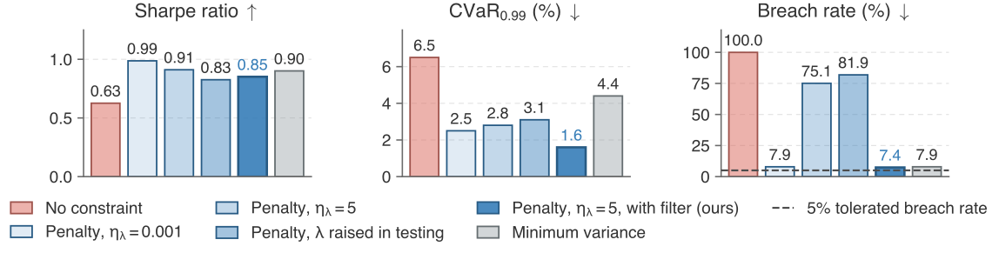
</p>
<p align="center"><em>Only the decision-time filter (dark blue) combines the lowest tail loss with a breach rate near the 5% tolerance. Stress window, five-seed means; CVaR<sub>0.99</sub> is the mean loss in the worst 1% of weeks, breach rate the share of test weeks over budget.</em></p>

<table>
  <tr>
    <td width="50%">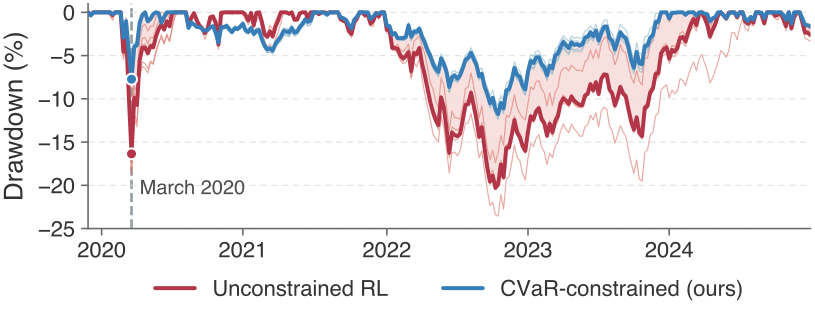</td>
    <td width="50%">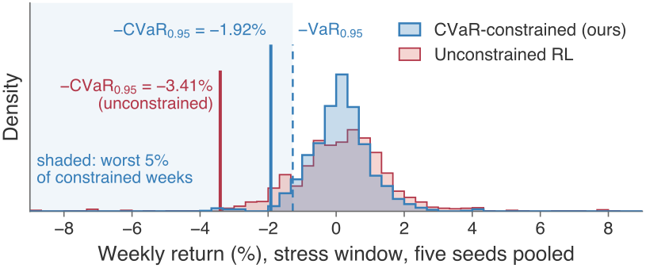</td>
  </tr>
  <tr>
    <td align="center"><em>The constrained allocator loses about half as much: 7.7% vs 16.3% drawdown in March 2020. Five-seed means, 2020–2024.</em></td>
    <td align="center"><em>The constraint thins the left tail of weekly returns. Stress window, five seeds pooled.</em></td>
  </tr>
  <tr>
    <td width="50%">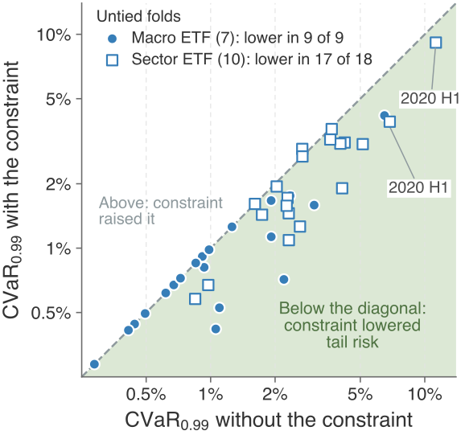</td>
    <td width="50%">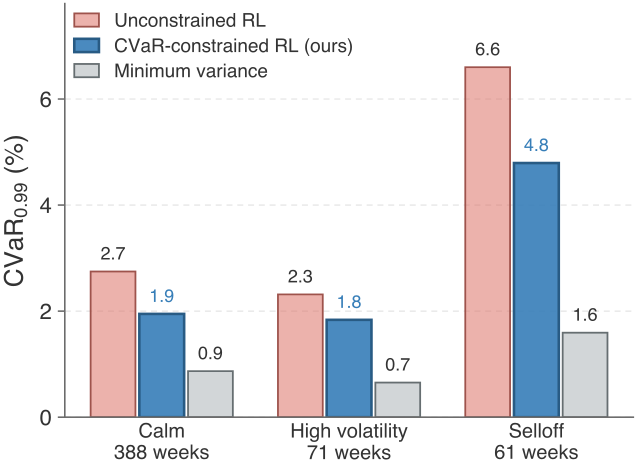</td>
  </tr>
  <tr>
    <td align="center"><em>The constraint lowers tail risk in 26 of 27 untied walk-forward folds (points below the diagonal).</em></td>
    <td align="center"><em>The constraint cuts CVaR<sub>0.99</sub> in every regime, though minimum variance stays lower still. 10-fold macro walk-forward.</em></td>
  </tr>
</table>

<details>
<summary><b>Paper figures</b></summary>

<br/>

<p align="center">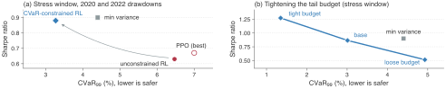</p>
<p align="center">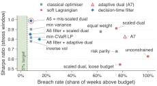</p>
<p align="center">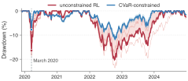</p>
<p align="center">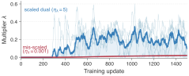</p>

</details>

**Setup.** Weekly data 2008–2024, 5 bps transaction costs, long-only with a 0.40 weight cap and 0.50 turnover cap, CVaR₉₅ budget $`d=1.2\%`$. Three universes: seven macro ETFs, ten sector ETFs and a 31-asset cross-asset universe. All features and filter inputs use information strictly before each decision. Baselines: cash, equal weight, inverse volatility, minimum variance, mean-variance, risk parity, min-CVaR, plus model-free A2C, PPO and SAC.

---

## 🗂️ Repository structure

```text
cvar-rl-portfolio-allocator/
├── paper/                  # camera-ready paper
│   ├── main.tex · main.pdf · references.bib
│   └── figures/            # the four figures the paper includes
├── poster/                 # A0 conference poster
│   ├── poster.tex · poster.pdf
│   ├── figures/            # the seven poster figures
│   └── logos/
├── src/crlpa/              # library
│   ├── data/               # Yahoo / FRED loaders, weekly panel builder
│   ├── envs/               # allocation environment, admissible-set projection
│   ├── features/           # return, risk, factor and macro state
│   ├── models/             # actor, critic, safety critic (A2C baseline)
│   ├── policies/           # classical baselines
│   ├── training/           # differentiable allocator, Lagrangian, CVaR filter, PPO, SAC
│   └── evaluation/         # metrics, backtest, walk-forward, bootstrap, statistics
├── scripts/                # one script per experiment, table or figure
├── configs/                # macro-ETF, sector-ETF and 31-asset experiment configs
├── results/                # committed result tables behind every reported number
├── tests/                  # no-look-ahead, constraints, accounting, models, statistics
└── data/                   # empty: market data is rebuilt locally, never committed
```

---

## 🚀 Quick start

```bash
git clone https://github.com/nl2992/cvar-rl-portfolio-allocator.git
cd cvar-rl-portfolio-allocator
python -m venv .venv && source .venv/bin/activate
pip install -e ".[dev,rl]"
pytest -q
```

The test suite runs on synthetic data and needs no downloads. To work with real prices, build the weekly return panels (Yahoo chart API, adjusted closes):

```bash
python scripts/build_dataset.py --config configs/experiment_etf.yaml
python scripts/build_dataset.py --config configs/experiment_sector.yaml
python scripts/build_dataset.py --config configs/experiment_large.yaml
```

> [!NOTE]
> **No market data is redistributed.** The panels are written to `data/processed/` (git-ignored). Vendors revise historical adjusted prices, so a fresh download can differ slightly from the panels used in the paper; [`DATA_MANIFEST.sha256`](DATA_MANIFEST.sha256) records the hashes of the original panels (`shasum -a 256 -c DATA_MANIFEST.sha256`).

---

## 🔁 Reproducing the paper

Published numbers use Python 3.12.2 and the pinned [`requirements.lock.txt`](requirements.lock.txt):

```bash
uv venv --python python3.12 .venv-lock
uv pip install --python .venv-lock/bin/python -r requirements.lock.txt
source .venv-lock/bin/activate
export PYTHONPATH=src
```

Build the three panels as in [Quick start](#-quick-start), then run any row below from the repository root. Training studies are compute-heavy; every committed table under `results/` lets you check numbers without retraining.

| Paper / poster result | Command | Output |
| --- | --- | --- |
| Stress-window comparison (Fig. 4) | `python scripts/run_diff_study.py` | [`results/tables_diff/`](results/tables_diff/) |
| BCa bootstrap intervals | `python scripts/cr_bootstrap_intervals.py --universe etf` (and `sector`) | [`bootstrap_intervals_*.csv`](results/tables_camera_ready/) |
| Classical baselines | `python scripts/run_baselines.py` | [`baseline_metrics_etf.csv`](results/tables/baseline_metrics_etf.csv) |
| Model-free A2C | `python scripts/train_allocator.py` → `python scripts/evaluate_allocator.py` | [`results/tables_etf/`](results/tables_etf/) |
| PPO / SAC sweeps | `python scripts/run_ppo_sweep.py`, `python scripts/run_sac_sweep.py` | `results/tables_ppo/`, `results/tables_sac/` |
| Failure 1: coupling study | `python scripts/coupling_fix_ablation.py` | [`coupling_fix_summary.csv`](results/tables_ablations/coupling_fix_summary.csv) |
| CVaR permutation test | `python scripts/cvar_permutation_test.py` | [`cvar_permutation_test.json`](results/tables/cvar_permutation_test.json) |
| Checkpoint-selection log | `python scripts/cr_selection_log.py` then `--summarise` | [`selection_log_summary.csv`](results/tables_camera_ready/selection_log_summary.csv) |
| λ trace (Fig. 2) | `python scripts/cr_lambda_trace.py` | [`lambda_trace.csv`](results/tables_camera_ready/lambda_trace.csv) |
| Budget-setting rules | `python scripts/task3_budget_rules.py`, `python scripts/task3_rule3_fixed.py` | [`results/tables_reanalysis/`](results/tables_reanalysis/) |
| Decision-time filter (Fig. 3) | `python scripts/task12_analysis.py` → `python scripts/task4_risk_filter.py` | [`task4_filter_arms_summary.csv`](results/tables_reanalysis/task4_filter_arms_summary.csv) |
| Two-universe walk-forward folds | `python scripts/run_stats_study.py` → `python scripts/cr_fold_stats.py` | [`results/tables_stats/`](results/tables_stats/), [`fold_stats.json`](results/tables_camera_ready/fold_stats.json) |
| Macro walk-forward + regimes | `python scripts/run_walk_forward.py` → `python scripts/compile_regime_table.py` | [`results/tables_wf/`](results/tables_wf/), [`regime_comparison.csv`](results/tables/regime_comparison.csv) |
| Regime-switching hybrid | `python scripts/run_hybrid_overlay.py`, `python scripts/run_hybrid_threshold_sweep.py` | [`hybrid_overlay_table.csv`](results/tables/hybrid_overlay_table.csv) |
| Crisis timing | `python scripts/run_crisis_timing.py` | [`crisis_timing_table.csv`](results/tables/crisis_timing_table.csv) |
| Ablations & robustness | `python scripts/run_ablations.py`, `python scripts/run_robustness.py` | [`results/tables_ablations/`](results/tables_ablations/), [`results/tables_robustness/`](results/tables_robustness/) |
| Macro / factor features | `python scripts/run_macro_study.py` | [`results/tables_macro/`](results/tables_macro/) |
| Failure 2: protocol reversal | `python scripts/make_reversal_figure.py` | [`protocol_sharpe.csv`](results/tables_protocol/protocol_sharpe.csv) |
| Ledoit–Wolf check, 31 assets | `python scripts/cr_shrinkage_large31.py` | [`shrinkage_large31_stress.csv`](results/tables_camera_ready/shrinkage_large31_stress.csv) |
| Stress paths | `python scripts/cr_stress_paths.py` | [`stress_paths.csv`](results/tables_camera_ready/stress_paths.csv) |

Rebuild the figures, the paper and the poster:

```bash
python scripts/make_stress_paths_figure.py
python scripts/make_lambda_trace_figure.py
python scripts/make_filter_frontier_figure.py
python scripts/make_hero_figure.py
python scripts/make_poster_figures.py
(cd paper && latexmk -pdf main.tex)
(cd poster && latexmk -pdf poster.tex)
```

The 31-asset walk-forward folds were not retained, so `make_reversal_figure.py` rebuilds that comparison from the values reported in the paper rather than retraining. See [`results/tables_camera_ready/README.md`](results/tables_camera_ready/README.md) for the exact environment the camera-ready tables were regenerated in.

---

## 📝 Citation

```bibtex
@inproceedings{li2026tailconstraints,
  title     = {Making Tail Constraints Bind: Two Silent Failure Modes in
               {CVaR}-Constrained Portfolio {RL}},
  author    = {Li, Nigel and Han, Yutong},
  booktitle = {Proceedings of the 7th ACM International Conference on AI in Finance (ICAIF '26)},
  year      = {2026},
  address   = {Milan, Italy},
  publisher = {ACM}
}
```

The DOI will be added after publication. GitHub's **Cite this repository** button reads [`CITATION.cff`](CITATION.cff).

---

## 📄 License

Code is released under the [MIT License](LICENSE).
